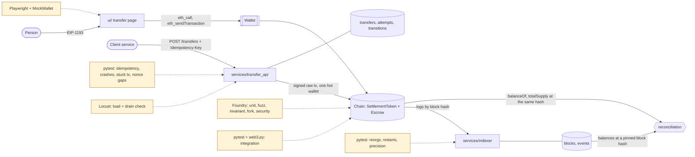

# tokenized-settlement-qa

[](https://github.com/yuri-spizhovyi-mit/tokenized-settlement-qa/actions/workflows/contracts.yml)
[](https://github.com/yuri-spizhovyi-mit/tokenized-settlement-qa/actions/workflows/integration.yml)
[](https://github.com/yuri-spizhovyi-mit/tokenized-settlement-qa/actions/workflows/ui.yml)
[](https://github.com/yuri-spizhovyi-mit/tokenized-settlement-qa/actions/workflows/nightly.yml)
[](https://yuri-spizhovyi-mit.github.io/tokenized-settlement-qa/)

**A tokenised settlement system whose real product is its test suite.** The
contracts are deliberately small: an allowlisted, pausable ERC-20 and an escrow with
an arbiter and EIP-712 signed releases. Around them sit the off-chain parts that
break in practice:
- a reorg-aware **indexer**;
- an idempotent **transfer API**;
- a one-page **wallet UI**.

Each part is tested at the level where its failures actually happen.

It is a portfolio project for a Digital Asset QA Engineer role, and the companion to
the book *Testing the Chain*.

## The story in two minutes

**What's tested.** 102 requirements, every one traced to at least one test by a
matrix that CI generates from the code and fails on a gap
([`docs/rtm.md`](docs/rtm.md)).

| Level | Tests | What it catches |
|---|---|---|
| Foundry unit, fuzz (10k runs), invariant (512 × 256), mainnet-USDC fork, security | 137 | wrong reverts, unauthorised calls, broken invariants, real-token behaviour, re-entrancy, signature replay |
| Python on Anvil: integration, indexer, reconciliation, transfer API, load smoke | 94 | what a client sees: nonces, receipts, time, reorgs, crashes, concurrency |
| Playwright UI with a scriptable EIP-1193 wallet | 32 | what the user sees, what the wallet was asked, what happened on chain |
| Locust, 40 users × 3 min, nightly | 1 rig | throughput, lag, and that nothing was lost under load |

The production contracts are at **100% line, statement, branch and function
coverage**. Slither runs on every PR and fails on any High finding.

**What the tests found.** 30 findings, each with evidence, in
[`docs/findings.md`](docs/findings.md). The ones a reviewer should read:

| | Finding | Why it matters |
|---|---|---|
| F-15 | After a reorg, a naive indexer keeps the abandoned block. Its block hash *and* total supply still reconcile; only per-holder balances expose it. | A bug that looks healthy on every summary check. |
| F-21 | Re-signing a transfer after a crash pays the recipient **twice**, while the status says `confirmed`. Fixed with write-ahead signed bytes that are rebroadcast, never re-signed. | "Retry" in payments must mean "resend the same thing". |
| F-19 | One refused send leaves a nonce gap, and every later transaction queues forever, with no error. | The hot wallet stalls silently. |
| F-23 | Under load the API accepted 33 transfers/s while settling 4/s; confirmations froze for over a minute. Fixed with bounded batches and 503 backpressure: **4.0 → 12.9 confirmed/s**. | A load test that gates on correctness, not speed. |
| F-16 | SQLite `NUMERIC` silently turns 2^63 + 1 into 2^63. | Off by one base unit, no error. |
| F-14 | A deadline test passed **for the wrong reason**: gas estimation ignores the pinned block time. | A green test that tested nothing. |
| F-27 | A mutation check showed the double-click test couldn't see the in-flight guard. A same-tick double-submit test now kills that mutant. | Proving the tests can fail. |
| F-01 | The planted `Deal memory` bug that pays one deal repeatedly is caught by the invariant suite. | The suite is proven against a real bug class. |

**How it's run.** Every PR runs all suites. Per CLAUDE.md, a PR merges only when CI is
green, every new test names its requirement, and every open behaviour choice is recorded
in [`docs/decisions.md`](docs/decisions.md) (41 so far). A `v*` tag builds the
**evidence pack**: raw results, coverage, Slither, the RTM and the process documents,
with SHA-256 sums. The pack is built only when everything passed.

## Architecture



| Component | What it does | Key decisions |
|---|---|---|
| `contracts/src/SettlementToken.sol` | ERC-20, 6 decimals; allowlist enforced in `_update` for sender, recipient and spender; pausable; one role per duty | TOK-D1, SEC-D2 |
| `contracts/src/Escrow.sol` | open → release by the arbiter, or refund to the payer from the deadline on; EIP-712 signed release; rotatable arbiter | ESC-D1..D6, SEC-D3/D4 |
| `services/indexer/` | parent-hash and tip checks, rollback to the common ancestor, confirmation depth, exact `Uint256` storage | IDX-D1..D6 |
| `services/transfer_api/` | idempotency keys, write-ahead signing, stuck-tx replacement, nonce re-sync, gap filling, backpressure | TAPI-D1..D8 |
| `ui/` | BigInt amounts, simulate before signing, large-value confirmation, honest rejection handling | UI-D1..D6 |

## Where to look

| If you want… | Read |
|---|---|
| the approach: risks, levels, exit criteria | [`docs/test-strategy.md`](docs/test-strategy.md) |
| requirement → test, generated | [`docs/rtm.md`](docs/rtm.md) (catalogue: [`docs/requirements.csv`](docs/requirements.csv)) |
| the threat model | [`docs/security-test-plan.md`](docs/security-test-plan.md) and [`docs/slither-triage.md`](docs/slither-triage.md) |
| what broke, with evidence | [`docs/findings.md`](docs/findings.md) |
| why it behaves as it does | [`docs/decisions.md`](docs/decisions.md) |
| the bottleneck under load | [`docs/performance-report.md`](docs/performance-report.md) |
| acceptance scripts for people | [`docs/uat-scripts.md`](docs/uat-scripts.md) |
| the latest test report | [Allure on GitHub Pages](https://yuri-spizhovyi-mit.github.io/tokenized-settlement-qa/) |
| how it was built, PR by PR | [`docs/plan.md`](docs/plan.md) |
| conventions for contributors and agents | [`CLAUDE.md`](CLAUDE.md) |

One test per area worth reading as an example:
- `contracts/test/invariant/Escrow.invariant.t.sol`: a handler with ghost variables.
- `tests/reconciliation/test_reconciliation.py::test_naive_indexer_fails_reconciliation_after_a_reorg`
- `tests/transfers/test_api_restart.py::test_crash_after_broadcast_then_restart_pays_exactly_once`
- `tests/ui/test_transfer_page.py::test_rejected_signature_sends_nothing_and_says_so`

## Quick start

You need Foundry **v1.8.7** and Python **3.12**. Full instructions for every suite,
including Postgres, Playwright, load and the evidence pack:
[`docs/how-to-run.md`](docs/how-to-run.md).

```bash
git clone --recurse-submodules https://github.com/yuri-spizhovyi-mit/tokenized-settlement-qa
cd tokenized-settlement-qa
(cd contracts && forge build && forge test)            # 137 Foundry tests (fork tests skip without MAINNET_RPC_URL)
python3.12 -m venv .venv && .venv/bin/pip install -r requirements.txt
.venv/bin/pytest                                       # Python suites on Anvil, ~2 min
.venv/bin/python -m playwright install chromium && .venv/bin/pytest tests/ui
```

The numbers above are as of the PR that last updated this README. The evidence pack
attached to each release has the authoritative counts for that commit.

## Repository layout

```text
contracts/   Foundry: src/ (2 production contracts), test/{unit,fuzz,invariant,fork,security,fixtures}
services/    indexer/, transfer_api/ (Python)
ui/          one-page transfer UI (vanilla JS, EIP-1193 only)
tests/       pytest: integration/, indexing/, reconciliation/, transfers/, load/, ui/
docs/        strategy, requirements + RTM, security plan, UAT, findings, decisions, reports
scripts/     cloud-setup.sh, rtm.py, evidence_pack.py, check_links.py
.github/     contracts, integration (+ traceability), ui, nightly (load), release (evidence pack)
```
